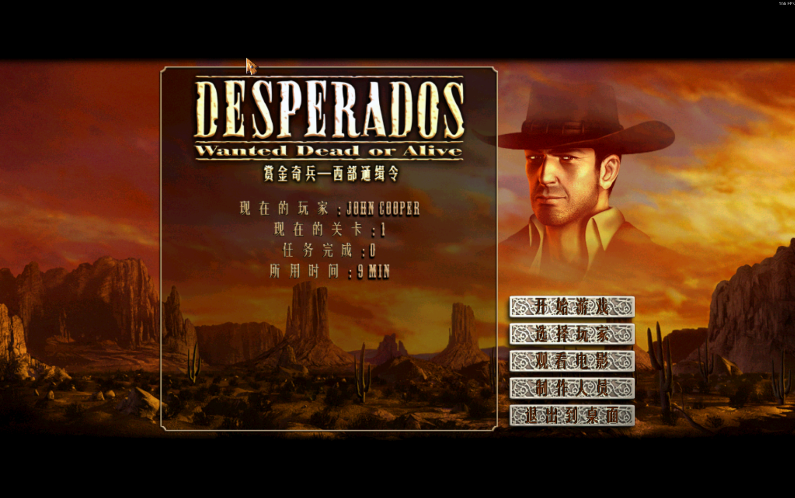
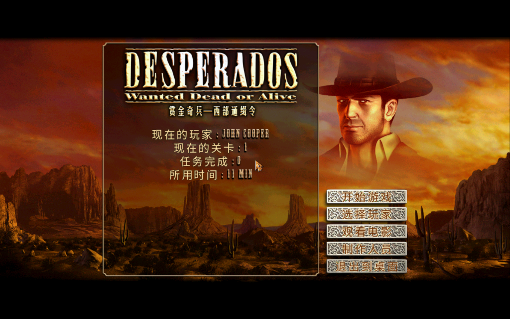

# Desperados - Wanted Dead or Alive 中文汉化修复

《赏金奇兵：西部通缉令》Steam 汉化补丁，包含主游戏和 Demo，支持自选游戏目录、安装前备份和统一还原。适用于 **Steam Build 2959430**（主程序 desperados.exe）。

## 下载与版本选择

在 [v2.2.1 发布页](https://github.com/newbility/Desperados_Wanted_Dead_or_Alive_Chinese/releases/tag/v2.2.1) 选择一种完整包即可，无需先装另一种字体版。请下载 ZIP 附件；GitHub 自动生成的 Source code 不含游戏汉化资源。

| 字体版本 | 完整安装包 | 适合需求 |
|---|---|---|
| **思源黑体 v2.2.1（菜单优化版）** | [Desperados_Chinese_SourceHanSans_v2.2.1.zip](https://github.com/newbility/Desperados_Wanted_Dead_or_Alive_Chinese/releases/download/v2.2.1/Desperados_Chinese_SourceHanSans_v2.2.1.zip) | 规则清晰的中文字形，菜单按钮已缩小并增加上下留白 |
| **原汉化字体 v2.1.0** | [Desperados_Chinese_Main_and_Demo_v2.1.0.zip](https://github.com/newbility/Desperados_Wanted_Dead_or_Alive_Chinese/releases/download/v2.2.1/Desperados_Chinese_Main_and_Demo_v2.1.0.zip) | 保留原官方简体中文版提取字库的风格 |

两个版本都包含主游戏 + Demo。原字体包与 v2.1.0 已发布文件字节相同；思源黑体版重制 13 套中文位图字库，不改已有译文。校验值见 [SHA256SUMS.txt](https://github.com/newbility/Desperados_Wanted_Dead_or_Alive_Chinese/releases/download/v2.2.1/SHA256SUMS.txt)。

## 字体实机对比

这里的“原版”指原汉化字体，并非未汉化的英文版。下面都是实际游戏截图，点击图片可查看原尺寸；没有替换截图中的文字。

| 原汉化字体 | 思源黑体 v2.2.1 |
|---|---|
|  |  |

完整对比见 [字体对比与版本截图](docs/FONT_COMPARISON.md)，包含原字体、v2.2.0、v2.2.1 三版菜单、设置菜单及游戏内提示。早期合成预览不作为本页的实机对比。

## 安装、升级与还原

1. 关闭游戏并完整解压所选 ZIP，双击 **Install.cmd**。
2. 在窗口中选择 **包含 desperados.exe 的游戏根目录**；支持其他盘符、中文和空格路径。
3. 安装器校验游戏版本与资源，备份原文件后安装主游戏及 Demo 汉化。
4. 从 Steam 启动：下方 Wanted Dead or Alive 区域的英美旗帜进入主游戏，上方 Demo Mission 区域的英美旗帜进入 Demo。

从 v2.1.0 升级思源黑体版：保留旧“合并版汉化补丁”文件夹中的 installation.json 和 backups，将它与新版补丁文件夹放在同一父目录；或先用旧包 Restore.cmd 还原，再安装新版。

从 v2.2.0 升级：可将新版完整解压到原清晰版文件夹并覆盖程序和资源文件，**保留原有 installation.json 和 backups**，再运行 Install.cmd。若分开存放，将旧文件夹命名为“思源黑体清晰版汉化补丁_v2.2.0”，与新版文件夹并排。

需要还原时，关闭游戏后运行**安装时所用补丁文件夹**内的 Restore.cmd。它恢复到汉化前的原版游戏资源。若从思源黑体换回原汉化字体，先还原思源黑体版，再安装原字体包。不要直接把两个字体包叠加覆盖到游戏目录。

完整说明见 [使用说明](installer/使用说明.md)。仓库中的 installer 目录仅供查看和维护，请用 Release 的完整包安装。

## 汉化内容与本次更新

- 主游戏 1086 条对白、任务说明和提示，139 条菜单及状态文字。
- 13 套中文字库、中文主菜单背景与两张任务结算画面。
- 12 段过场视频、117 条中文字幕，保留原音轨。
- Demo 的 139 条菜单文字、6 页中文操作指南，复用 49 条中文对白及任务提示。
- 思源黑体版保留原有行高、字符前进宽度及拉丁字形，覆盖 1292 个映射汉字。
- v2.2.1 相对 v2.2.0 只调整四套菜单按钮字库：中文 em 从 27 缩至 22，描边收细，图集上下至少各留 5 像素；其他 27 个资源逐字节相同。

完整包包含 31 个资源，不替换游戏主程序。图片和过场视频中已经固化的文字沿用原汉化素材，不随实时字库改变。

## 验证与已知边界

已核验字库字符覆盖、原字距和拉丁像素、菜单上下边距，以及 v2.2.0 → v2.2.1 的真实 31 资源升级、重复安装和原版还原。安装器的 10 种异常与升级场景、中文/空格路径及目录窗口初始化检查通过。主菜单、设置菜单、提示等已进行实机检查。

尚未完整通关或逐条触发全部人物对白，部分关卡名、地名和键名仍为原文。高分辨率下仍受旧游戏位图缩放方式限制。记录见 [validation](validation)。

## 致谢

感谢 **小智2010** 从《赏金奇兵》**官方简体中文版中提取并分享的汉化补丁**。本项目以该补丁为基础适配 Steam 新版，并补充 Demo 汉化。

原补丁链接：[赏金奇兵1+2steam+gog汉化补丁（其乐 Keylol）](https://keylol.com/t100795-1-1)。思源黑体来自 Adobe Source Han Sans SC，遵循 SIL Open Font License 1.1。更多来源与许可见 [CREDITS.md](CREDITS.md)。
