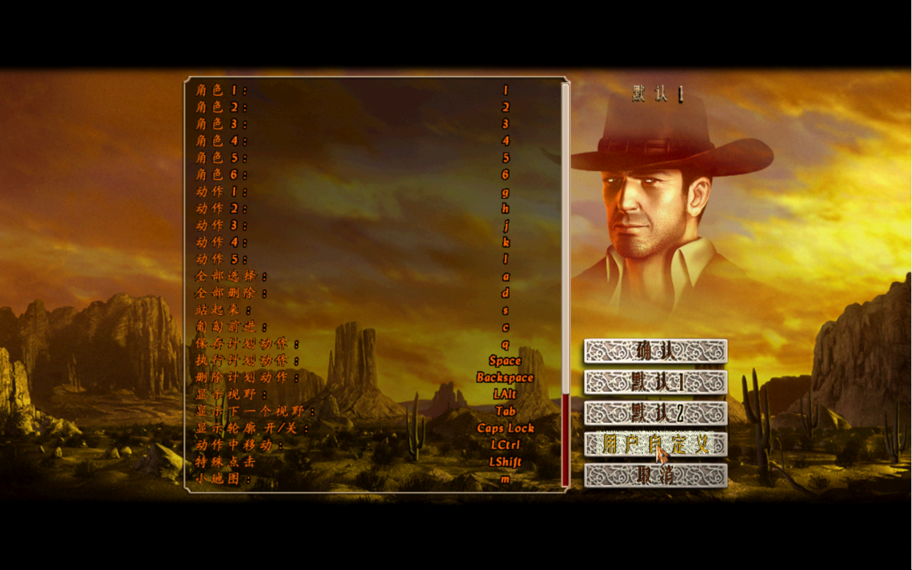
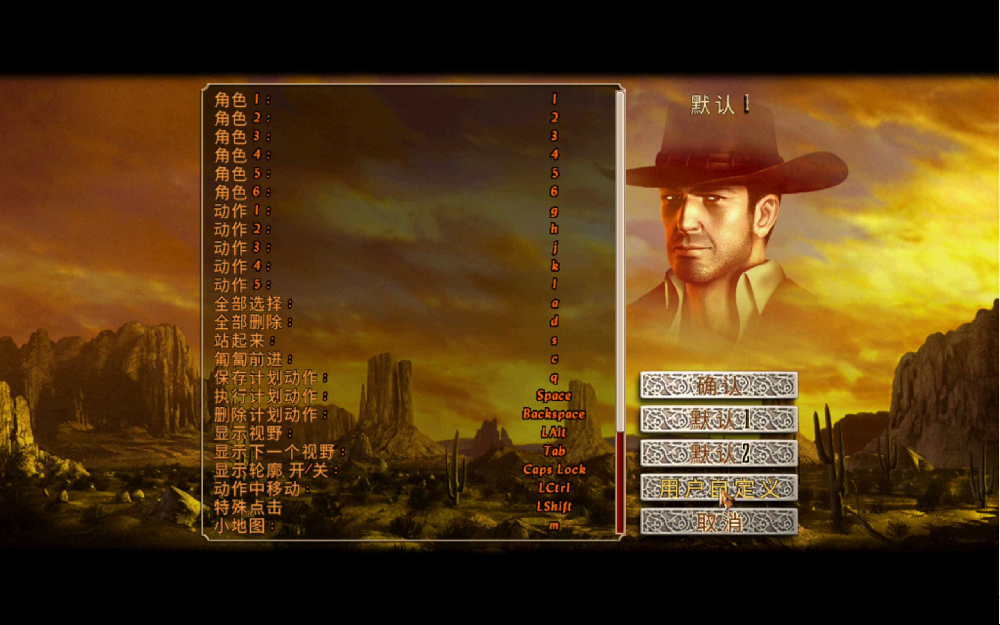
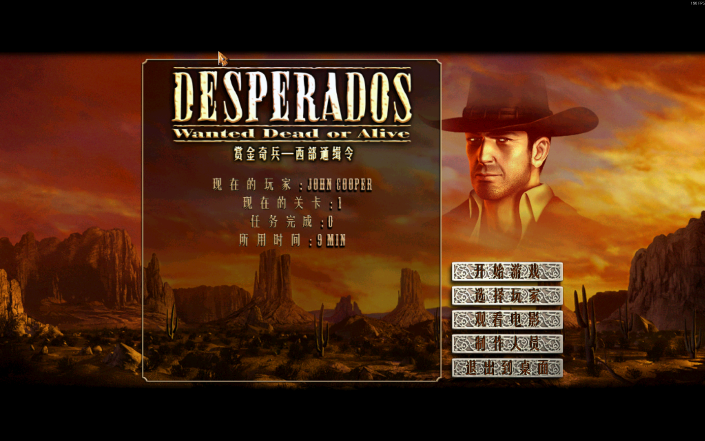
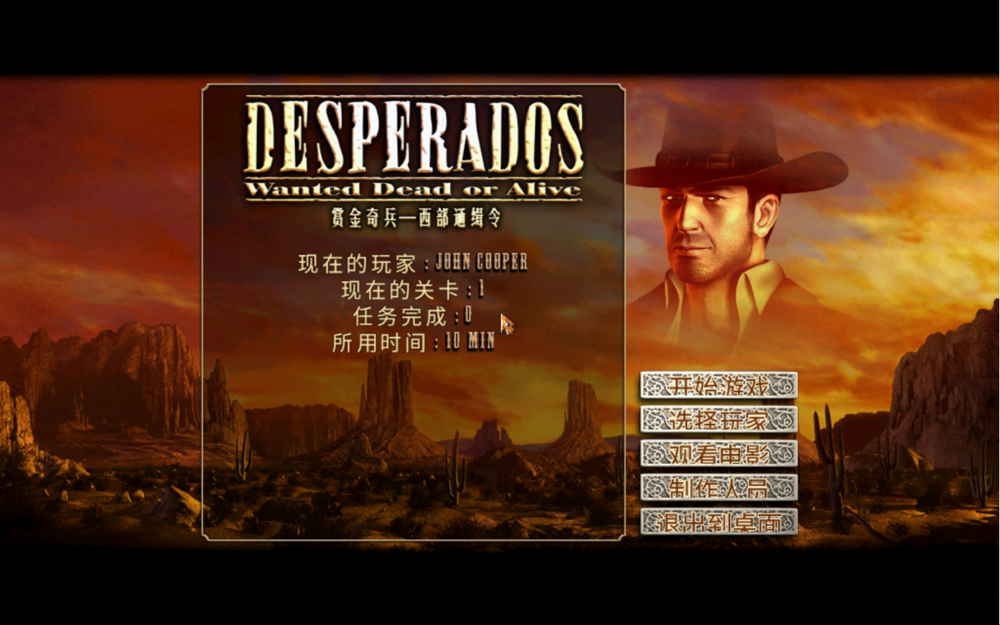
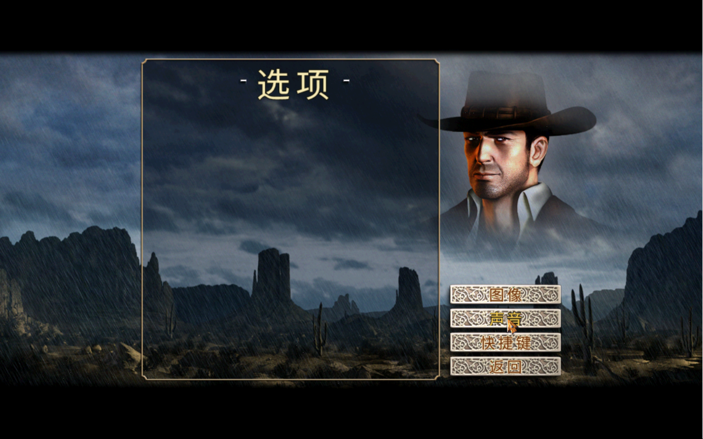
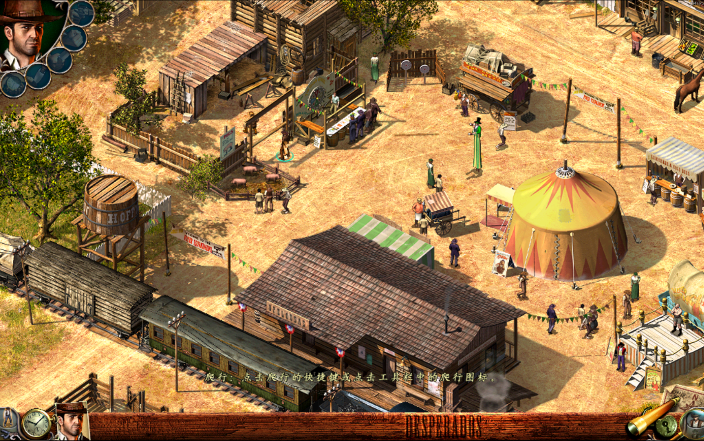
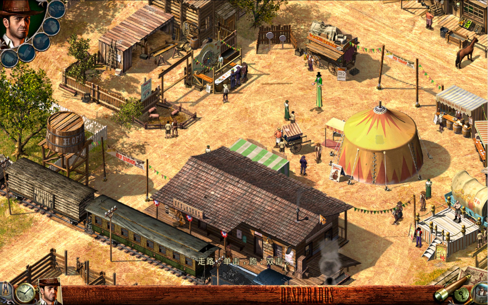
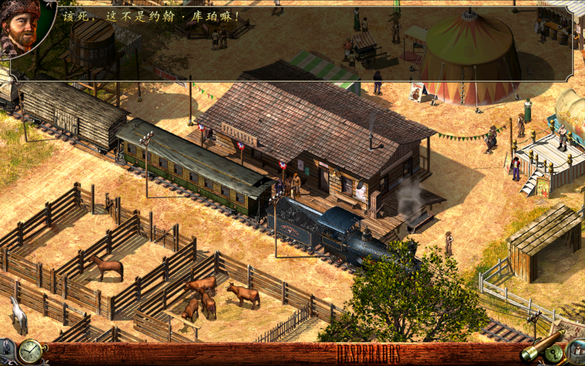
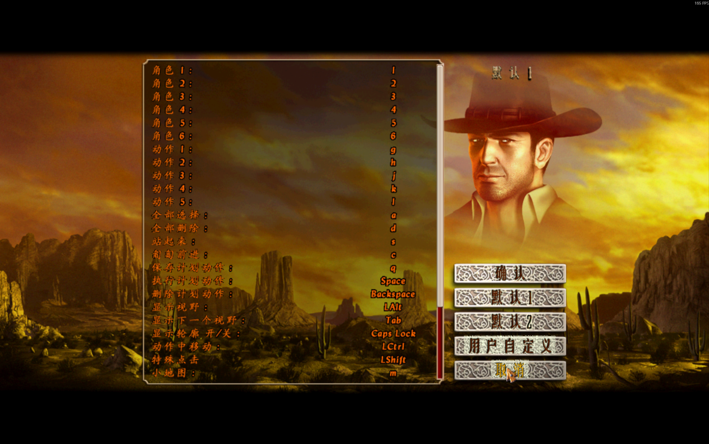

# 字体对比与版本截图

全部图片均为保留的实际游戏截图，按字节原样复制；本页不使用早期合成预览。点击图片可查看原尺寸。不同截图中的游戏时间、鼠标位置、窗口宽度及任务提示文字可能不同，不能把它们当作相同帧的像素差分。

## v2.3.0 黑框修复实机对比

| 原汉化字体 | 思源黑体 |
|---|---|
|  |  |

两套字体的快捷键列表在本机均能显示中文和键名，行距正常。两套字库的纹理宽度均为 4096 像素，保留各自的字形和字距。

[Demo 中文操作指南实机截图](images/sourcehan-v2.3.0-demo-guide.png) · [v2.3.0 下载](https://github.com/newbility/Desperados_Wanted_Dead_or_Alive_Chinese/releases/tag/v2.3.0)

最终 ZIP 已解压并逐文件核验，通过 13 项安装回归，包括旧包升级、字体互换及还原。两位 AMD 玩家和开场对白待复测。

## 主菜单：原汉化字体与思源黑体

| 原汉化字体 | 思源黑体 v2.2.0 | 思源黑体 v2.2.1 |
|---|---|---|
|  |  |  |

v2.2.0 已重制思源黑体，但菜单按钮文字偏满。v2.2.1 只缩小四套按钮字库中的中文、收细描边并重新安排基线，增加边框内的上下留白。按钮背景、位置和字符前进宽度不变；菜单中玩家状态等其他字体保持 v2.2.0 的效果。

## v2.2.1 设置菜单

“快捷键”和“返回”等按钮沿用同一组优化后的字库，普通与选中颜色保持区分。

## 游戏内提示

| 原汉化字体：匍匐提示 | 思源黑体：走路提示 |
|---|---|
|  |  |

两张图的提示文字和镜头不同，用于展示字形风格与可读性。右图采自 v2.2.0；v2.2.1 的提示字库与该版本逐字节相同，仅菜单按钮进行了后续调整。

## 其他保留的原字库截图

| 原字体人物对白 | 原字体按键列表 |
|---|---|
|  |  |

这里仅列出可确认来源的原图，不用合成预览补作思源黑体实机对白。全部公开截图的尺寸、版本说明和 SHA-256 见 [screenshots.json](../validation/screenshots.json)。

[返回项目首页](../README.md)
